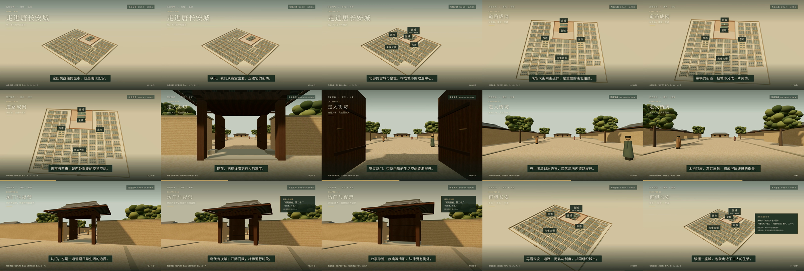

# 《走进唐长安城》交付文件

60 秒中文科普短片，横屏 1920 × 1080，30 fps，H.264 / yuv420p + AAC。

## 下载

- [成片：changan.mp4](./changan.mp4)
- [8 秒穿坊门测试：changan-gate-test.mp4](./changan-gate-test.mp4)
- [中文配音稿](./changan-voiceover.txt)
- [独立中文字幕 SRT](./changan.zh-CN.srt)
- [资料出处与情境演绎说明](./changan-sources.md)
- [媒体验证结果](./changan-media-check.json) · [镜头与画面检查记录](./changan-qa.json)

**视频文件在 GitHub 中可能不提供在线预览。** 打开 MP4 文件页后，点击右上方 **Download raw file / 下载原始文件**。也可以在仓库选择 `changan-delivery` 分支，点击 **Code → Download ZIP**，一次下载全部交付文件和源码。

本版视频包含**中文字幕与轻环境声，未录入人声配音**；中文配音稿另附，按时间段与字幕对齐。

## 内容与验证

依次呈现全城鸟瞰、道路网格、走入街坊、坊门管理、拉回全城。全城图标注“布局示意”，街景标注“情境演绎”，片尾附文献简称；完整出处与推演范围见资料说明。

8 秒测试已实际渲染并检查通行路径、建筑比例及字幕。全片 1800 帧、测试片 240 帧，均完整解码通过；片尾雾效切换问题已修正并复验。建筑尺寸为情境推演，不能视为考古实测复原。

## 源码与重渲染

- 场景：[`src/changan`](../../src/changan/)
- 制作说明：[`docs/changan-production.md`](../../docs/changan-production.md)
- 重渲染脚本：[`scripts/render-changan.sh`](../../scripts/render-changan.sh)
- 文件校验：[`SHA256SUMS`](./SHA256SUMS)

`out/` 是本地渲染工作目录，未纳入 Git；本目录包含实际可下载的最终交付文件。
